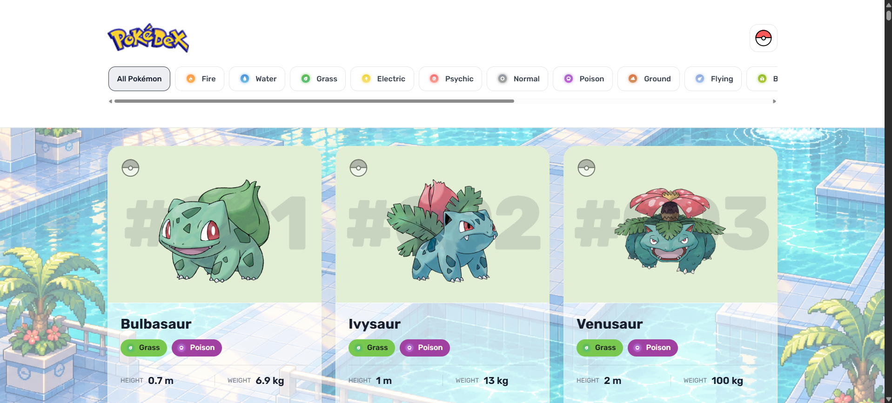
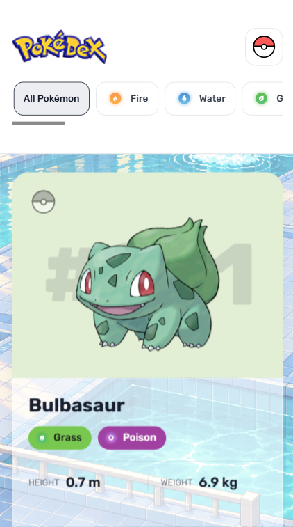
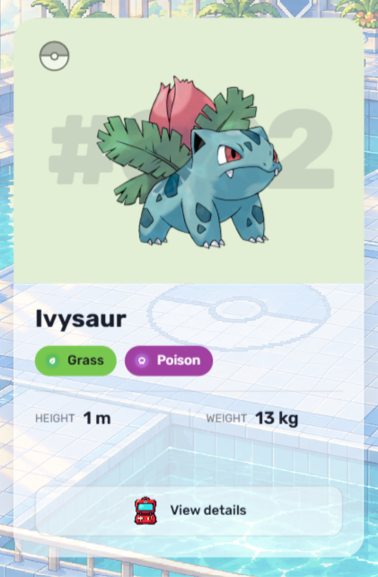
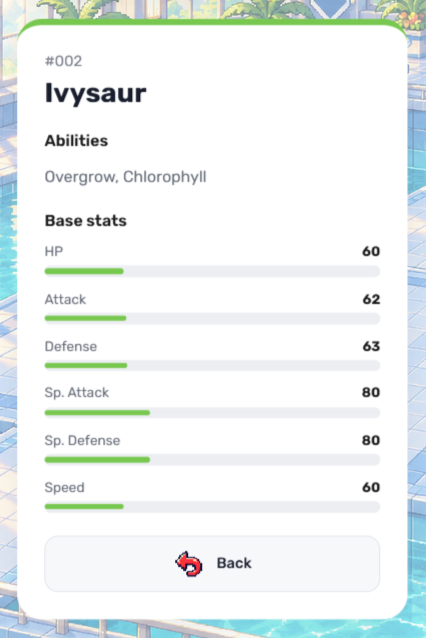

# Pokédex

A responsive Pokédex built with HTML, CSS and JavaScript, powered by PokéAPI.

Explore the original 151 Pokémon, filter them by type, save your favorites and flip each card to discover abilities and base stats.

## Features

- Responsive layout for desktop, tablet and mobile
- Pokémon type filters
- Favorites saved locally with localStorage
- Interactive flip cards
- Abilities and base stats
- Glass effect and a fixed pixel art background

## Technologies

- HTML5
- CSS3
- JavaScript
- PokéAPI

## Screenshots

### Desktop

### Mobile and interactive cards

  
  
  

## Run locally

1. Clone the repository.
2. Open the project in VS Code.
3. Open assets/index.html using the Live Server extension.

An internet connection is required to load Pokémon data and artwork.

## Credits

Developed as an extension of the DIO Pokédex challenge, with a custom interface and additional features.

Pokémon data and artwork provided by PokéAPI.
Pokémon belongs to its respective owners.